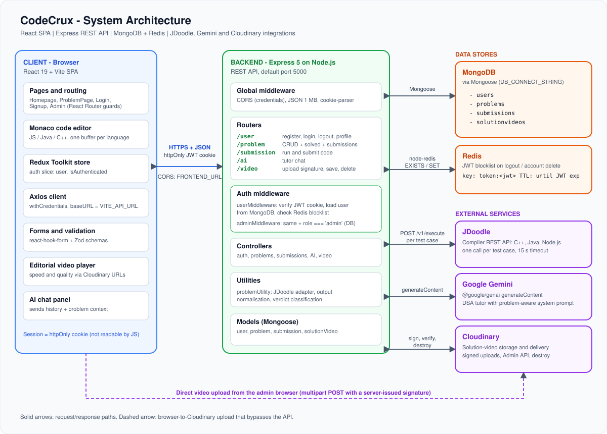
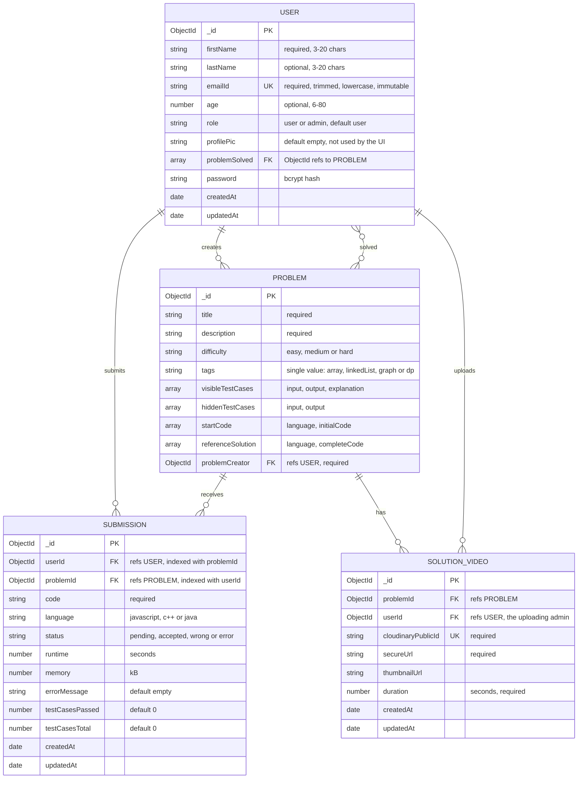
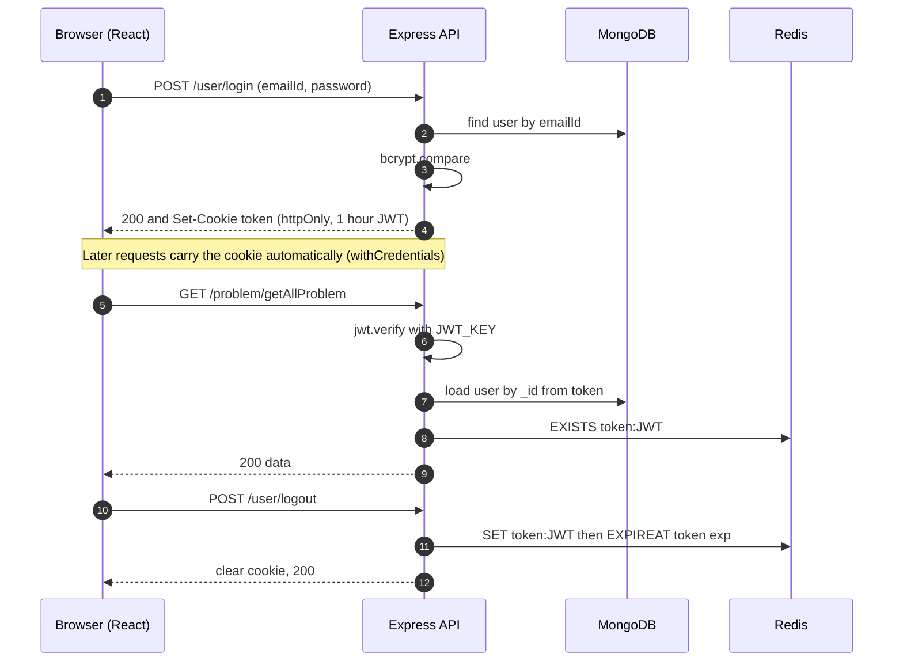
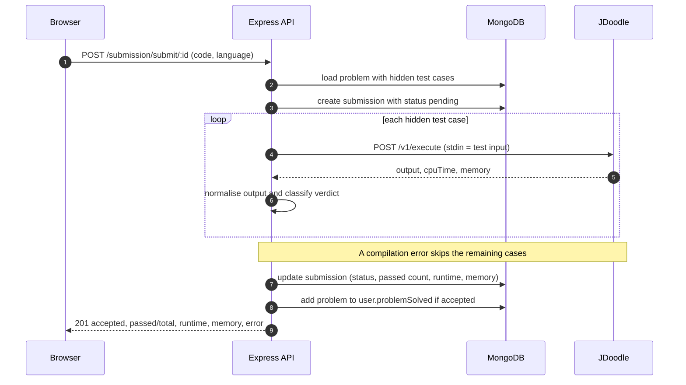
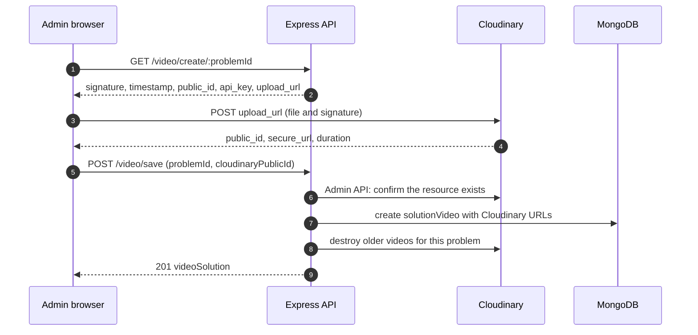

<div align="center">

# CodeCrux

**A full-stack, LeetCode-style coding practice platform: solve DSA problems in the browser, get judged against hidden test cases, and learn with an AI tutor and editorial videos.**


[Overview](#project-overview) |
[Features](#key-features) |
[Architecture](#architecture-overview) |
[Setup](#installation-and-local-setup) |
[API](#api-documentation) |
[Database](#database-schema)

</div>

---

## Table of Contents

1. [Project Overview](#project-overview)
2. [Key Features](#key-features)
3. [Technology Stack](#technology-stack)
4. [Architecture Overview](#architecture-overview)
5. [Project Structure](#project-structure)
6. [Installation and Local Setup](#installation-and-local-setup)
7. [Environment Variables](#environment-variables)
8. [Running the Application](#running-the-application)
9. [API Documentation](#api-documentation)
10. [Database Schema](#database-schema)
11. [Authentication and Authorization](#authentication-and-authorization)
12. [Technical Implementation Details](#technical-implementation-details)
13. [Error Handling and Validation](#error-handling-and-validation)
14. [Application Preview](#application-preview)
15. [Future Improvements](#future-improvements)
16. [Author and Links](#author-and-links)

---

## Project Overview

CodeCrux is a coding practice platform in the style of LeetCode. Learners browse data-structures-and-algorithms problems, write a solution in an in-browser Monaco editor (JavaScript, Java or C++), **Run** it against the visible sample cases, and **Submit** it to be judged against hidden test cases. Administrators author problems, attach editorial videos and manage other admins from a built-in admin area.

**The engineering problem it addresses:** a practice platform has to execute untrusted code, judge it fairly, and keep answer data away from learners. CodeCrux handles this by:

- delegating code execution to the [JDoodle](https://www.jdoodle.com/) compiler API instead of running user code on its own server;
- classifying verdicts from normalised program output;
- exposing hidden test cases only to admins, and reference solutions only to admins and to users who have already solved the problem;
- verifying every reference solution against the visible test cases before a problem can be saved.

---

## Key Features

Everything below is implemented in the repository.

### For learners

- **Account system:** register, log in, log out. The session lives in an `httpOnly` cookie holding a 1-hour JWT.
- **Problem browser:** filter by status (all or solved), difficulty (easy, medium, hard) and topic tag (array, linkedList, graph, dp). The header shows total solved and solved counts per difficulty.
- **Problem workspace:** split-pane view with the description and examples on the left and a Monaco code editor on the right. Starter code is loaded per language, and each language keeps its own editor buffer.
- **Run vs. Submit:** *Run* executes the visible test cases and shows input, expected output and actual output per case. *Submit* executes the hidden test cases and returns a verdict with passed/total, runtime and memory.
- **Submission history:** every attempt for a problem is stored, listed newest first, and can be opened in a code viewer.
- **AI tutor:** a Gemini-powered chat panel that gives hints, reviews code and explains complexity, grounded in the current problem.
- **Editorial video:** a custom video player with playback speed (0.5x to 2x) and quality selection (Original, 1080p, 720p, 480p, 360p).
- **Solutions tab:** reference solutions become visible only after the user has solved that problem.

### For administrators

- **Problem management:** create, update and delete problems through a validated form (title, description, difficulty, tag, visible and hidden test cases, starter code and reference solution for each language).
- **Reference solution verification:** the server runs each reference solution against the visible test cases and rejects the problem if any fails.
- **Video management:** upload an editorial video straight to Cloudinary, replace it, or delete it.
- **Admin registration:** an existing admin can create additional admin accounts.
- **Clean deletion:** deleting a problem also removes its submissions, solved-list references and Cloudinary videos.

---

## Technology Stack

Versions are the ranges declared in each `package.json`.

| Layer | Technology |
| --- | --- |
| **Frontend** | React 19, Vite 8, React Router 8, Redux Toolkit 2 with React-Redux, Tailwind CSS 4 with DaisyUI 5, Monaco Editor (`@monaco-editor/react`), React Hook Form with Zod 4 (`@hookform/resolvers`), Axios, lucide-react |
| **Backend** | Node.js, Express 5, Mongoose 9, node-redis 6, `jsonwebtoken`, `bcrypt`, `validator`, `cookie-parser`, `cors`, `dotenv`, Axios (JDoodle client) |
| **Database** | MongoDB (via Mongoose), Redis (token blocklist) |
| **External services** | JDoodle (code execution), Google Gemini via `@google/genai` (AI tutor), Cloudinary (video storage and delivery) |
| **Tooling** | ESLint 10 with `react-hooks` and `react-refresh` plugins, Vite dev server, `node --watch` for backend auto-reload |

---

## Architecture Overview

<p align="center">
  
</p>

CodeCrux is a two-tier application with a separately hosted single-page frontend and a stateless REST API. The API is the only component that touches MongoDB, Redis, JDoodle and Gemini. The one exception is video upload, where the browser sends the file straight to Cloudinary using a signature issued by the API.

| Component | Responsibility |
| --- | --- |
| **React SPA** | Routing with auth guards, editor UI, forms with client-side validation, session bootstrap through `GET /user/check`. Redux holds only authentication state. |
| **Express API** | Route handling, JWT verification, role checks, input validation, orchestration of external services. Mounts five routers (`/user`, `/problem`, `/submission`, `/ai`, `/video`) plus `GET /health`. |
| **MongoDB** | Persistent data: users, problems, submissions and solution-video metadata. |
| **Redis** | Blocklist of logged-out JWTs. Each entry expires when the token itself would have expired. |
| **JDoodle** | Compiles and runs submitted code; called once per test case. |
| **Gemini** | Produces tutor replies from the conversation plus the problem context. |
| **Cloudinary** | Stores and serves editorial videos; the API signs uploads and verifies or deletes resources through its Admin API. |

**Typical data flow (submitting a solution):** the browser posts code to `/submission/submit/:id` with its cookie, the API authenticates the user, loads the problem from MongoDB, creates a `pending` submission, calls JDoodle for each hidden test case, derives a verdict, updates the submission and the user's solved list, and returns a summary. A sequence diagram appears under [Technical Implementation Details](#technical-implementation-details).


---

## Project Structure

```text
CodeCrux/
├── backend/
│   ├── package.json
│   └── src/
│       ├── index.js                # Express bootstrap: CORS, JSON parsing, routers, /health, fallback error handler
│       ├── config/
│       │   ├── db.js               # Mongoose connection (DB_CONNECT_STRING)
│       │   └── redis.js            # node-redis client
│       ├── controllers/
│       │   ├── userAuthent.js      # register, login, logout, adminRegister, getProfile, deleteProfile
│       │   ├── userProblem.js      # problem CRUD, solved list, submission list
│       │   ├── userSubmission.js   # runCode, submitCode
│       │   ├── solveDoubt.js       # Gemini AI tutor
│       │   └── videoSection.js     # Cloudinary signature, save, delete
│       ├── middleware/
│       │   ├── userMiddleware.js   # JWT + DB user + Redis blocklist check
│       │   └── adminMiddleware.js  # same, plus role === 'admin'
│       ├── models/                 # user, problem, submission, solutionVideo
│       ├── routes/                 # userAuth, problemCreator, submit, aiChatting, videoCreator
│       └── utils/
│           ├── problemUtility.js   # JDoodle adapter, output normalisation, verdict classification
│           └── validator.js        # registration input validation
├── frontend/
│   ├── index.html
│   ├── package.json
│   ├── vite.config.js
│   ├── eslint.config.js
│   ├── public/
│   └── src/
│       ├── main.jsx                # Redux Provider + BrowserRouter
│       ├── App.jsx                 # Routes, auth guards, session bootstrap
│       ├── authSlice.js            # Redux Toolkit auth slice and async thunks
│       ├── store/store.js
│       ├── utils/axiosClient.js    # Axios instance (withCredentials) + error-message helper
│       ├── pages/                  # Homepage, Login, Signup, ProblemPage, Admin
│       └── components/             # ProblemForm, ChatAi, Editorial, SubmissionHistory, Admin* screens
├── docs/
│   ├── architecture.svg            # System architecture diagram
│   ├── database-schema.mmd         # Mermaid ER diagram source
│   └── screenshots/README.md       # How to add real screenshots
├── .gitignore
└── README.md
```

`package-lock.json` files, `node_modules/` and `frontend/dist/` are omitted above (the last two are git-ignored).

---

## Installation and Local Setup

### Prerequisites

| Requirement | Notes |
| --- | --- |
| **Node.js 22.22 or newer** | Required by the frontend dependency `react-router` 8.5 (its `engines` field is `>=22.22.0`). The backend's `dev` script uses `node --watch`. |
| **MongoDB** | A local instance or a hosted cluster; you need a connection string. |
| **Redis** | A local or hosted instance. The API connects to it at startup. |
| **JDoodle API credentials** | Client ID and secret, needed to run and submit code. |
| **Google Gemini API key** | Needed for the AI tutor. |
| **Cloudinary account** | Cloud name, API key and secret, needed for editorial videos. |

The JDoodle, Gemini and Cloudinary keys are only checked when the related feature is used, so the rest of the app can be explored without them.

### Steps

1. **Clone the repository**

   ```bash
   git clone https://github.com/Nesar03/CodeCrux.git
   cd CodeCrux
   ```

2. **Install and configure the backend**

   ```bash
   cd backend
   npm install
   ```

   Create `backend/.env` using the [variables below](#environment-variables).

3. **Install and configure the frontend**

   ```bash
   cd ../frontend
   npm install
   ```

   Optionally create `frontend/.env` with `VITE_API_URL` (defaults to `http://localhost:5000`).

4. **Start both servers** in separate terminals, as described in [Running the Application](#running-the-application).

5. **Create your first admin.** Registration through the UI always creates a regular `user`, and `POST /user/admin/register` itself requires an existing admin, so there is no seed script. Register normally, then promote that account directly in MongoDB (`users` is the collection Mongoose derives from the `user` model):

   ```js
   // mongosh, connected to the database named in DB_CONNECT_STRING
   db.users.updateOne({ emailId: "you@example.com" }, { $set: { role: "admin" } })
   ```

   Refresh the page (or log in again) and an **Admin** entry appears in the user menu. From there you can create problems and further admins.

---

## Environment Variables

All variables below are read in the code. Never commit real values; `.env` files are already git-ignored.

### Backend (`backend/.env`)

| Variable | Required | Purpose |
| --- | --- | --- |
| `DB_CONNECT_STRING` | Yes | MongoDB connection string. |
| `JWT_KEY` | Yes | Secret used to sign and verify JWTs. Use a long random value. |
| `REDIS_HOST` | Yes | Redis host. |
| `REDIS_PORT` | Yes | Redis port. |
| `REDIS_PASS` | No | Redis password. The username is fixed to `default` in `config/redis.js`. |
| `JDOODLE_CLIENT_ID` | For run/submit | JDoodle client ID. Also needed when creating or updating problems, because reference solutions are executed. |
| `JDOODLE_CLIENT_SECRET` | For run/submit | JDoodle client secret. |
| `GEMINI_KEY` | For AI tutor | Google Gemini API key. |
| `GEMINI_MODEL` | No | Gemini model name. The code falls back to `gemini-3.8-flash`; set this explicitly if that model is not available to your key. |
| `CLOUDINARY_CLOUD_NAME` | For videos | Cloudinary cloud name. |
| `CLOUDINARY_API_KEY` | For videos | Cloudinary API key (also returned to the admin browser for signed uploads). |
| `CLOUDINARY_API_SECRET` | For videos | Cloudinary API secret. Server-side only. |
| `FRONTEND_URL` | No | Allowed CORS origin. Default: `http://localhost:5173`. |
| `PORT` | No | API port. Default: `5000`. |
| `NODE_ENV` | No | When `production`, the auth cookie is `Secure` with `SameSite=None`; otherwise `SameSite=Lax`. |

Example `backend/.env` with placeholders:

```env
PORT=5000
NODE_ENV=development
FRONTEND_URL=http://localhost:5173

DB_CONNECT_STRING=<your-mongodb-connection-string>
JWT_KEY=<long-random-secret>

REDIS_HOST=<redis-host>
REDIS_PORT=<redis-port>
REDIS_PASS=<redis-password-if-any>

JDOODLE_CLIENT_ID=<jdoodle-client-id>
JDOODLE_CLIENT_SECRET=<jdoodle-client-secret>

GEMINI_KEY=<gemini-api-key>
# GEMINI_MODEL=<model-name>

CLOUDINARY_CLOUD_NAME=<cloud-name>
CLOUDINARY_API_KEY=<api-key>
CLOUDINARY_API_SECRET=<api-secret>
```

### Frontend (`frontend/.env`)

| Variable | Required | Purpose |
| --- | --- | --- |
| `VITE_API_URL` | No | Base URL of the API. Default: `http://localhost:5000`. |

> **Deploying the frontend and API on different domains?** Set `NODE_ENV=production` on the API (this enables `Secure` and `SameSite=None` on the cookie), set `FRONTEND_URL` to the exact frontend origin, and set `VITE_API_URL` at build time to the API's URL. The API also calls `app.set('trust proxy', 1)`, which assumes one reverse proxy in front of it.

---

## Running the Application

Scripts below are taken directly from each `package.json`.

### Backend (`cd backend`)

| Command | What it does |
| --- | --- |
| `npm run dev` | Starts the API with `node --watch src/index.js` (auto-restart on changes). |
| `npm start` | Starts the API with `node src/index.js`. |

The server begins listening only after MongoDB and Redis are connected. Check it with:

```bash
curl http://localhost:5000/health
# {"ok":true}
```

### Frontend (`cd frontend`)

| Command | What it does |
| --- | --- |
| `npm run dev` | Starts the Vite dev server (Vite's default is `http://localhost:5173`, matching the API's default CORS origin). |
| `npm run build` | Produces a production bundle in `frontend/dist`. |
| `npm run preview` | Serves the built bundle locally. |
| `npm run lint` | Runs ESLint over the frontend. |


---

## API Documentation

**Conventions**

- **Base URL:** `http://localhost:5000` by default.
- **Authentication:** protected routes read a JWT from the `token` cookie. Browsers send it automatically (`withCredentials`); with `curl` use `-c`/`-b` to store and send the cookie.
- **Request bodies:** JSON (`Content-Type: application/json`), limit 1 MB.
- **Response formats:** the API mixes plain-text bodies (most `/user` and `/problem` routes) with JSON bodies (`/submission`, `/ai`, `/video`, and successful data reads). Each endpoint below states which one it returns.
- **Auth failures:** a missing, invalid, expired or blocklisted token returns `401` with the plain text `Error: <reason>`. Admin routes also return `401` for non-admin users (`Error: Admin access required`).

### Endpoint summary

| Method | Path | Access | Description |
| --- | --- | --- | --- |
| GET | `/health` | Public | Liveness check |
| POST | `/user/register` | Public | Create a user account and start a session |
| POST | `/user/login` | Public | Log in and start a session |
| POST | `/user/logout` | User | End the session and blocklist the token |
| POST | `/user/admin/register` | Admin | Create another admin account |
| GET | `/user/check` | User | Return the current session's user |
| GET | `/user/getProfile` | User | Return the profile with solved problems |
| DELETE | `/user/deleteProfile` | User | Delete own account and submissions |
| POST | `/problem/create` | Admin | Create a problem |
| PUT | `/problem/update/:id` | Admin | Replace a problem's editable fields |
| DELETE | `/problem/delete/:id` | Admin | Delete a problem and related data |
| GET | `/problem/getAllProblem` | User | List all problems (summary fields) |
| GET | `/problem/problemById/:id` | User | Get one problem (fields depend on role) |
| GET | `/problem/problemSolvedByUser` | User | List problems the user has solved |
| GET | `/problem/submittedProblem/:pid` | User | List the user's submissions for a problem |
| POST | `/submission/run/:id` | User | Run code against visible test cases |
| POST | `/submission/submit/:id` | User | Submit code against hidden test cases |
| POST | `/ai/chat` | User | Ask the AI tutor |
| GET | `/video/create/:problemId` | Admin | Get a signed Cloudinary upload payload |
| POST | `/video/save` | Admin | Save uploaded video metadata |
| DELETE | `/video/delete/:problemId` | Admin | Delete a problem's solution video |

<details>
<summary><strong>Auth endpoints (<code>/user</code>)</strong></summary>

#### `POST /user/register`

Creates a user with role `user` (the role cannot be supplied by the client) and sets the `token` cookie.

```json
{
  "firstName": "Asha",
  "lastName": "Verma",
  "emailId": "asha@example.com",
  "password": "Str0ng!Pass",
  "age": 22
}
```

- `firstName`, `emailId`, `password` are required. `lastName` and `age` are optional.
- Password must satisfy `validator.isStrongPassword` defaults (8+ characters with lowercase, uppercase, number and symbol).
- Model limits: `firstName` and `lastName` 3 to 20 characters, `age` 6 to 80.

**`201`** (JSON):

```json
{
  "user": { "firstName": "Asha", "emailId": "asha@example.com", "_id": "…", "role": "user" },
  "message": "Registered Successfully"
}
```

**`400`** (text): `Error: Some Field Missing`, `Error: Invalid Email`, `Error: Weak Password: …`, `Error: Email already registered`, or a Mongoose validation message.

#### `POST /user/login`

Body: `{ "emailId": "…", "password": "…" }`. The email is trimmed and lower-cased before lookup.

**`200`** (JSON): `{ "user": { … }, "message": "Logged In Successfully" }` and a `token` cookie.
**`401`** (text): `Error: Invalid Credentials` (the same message for an unknown email and a wrong password).

#### `POST /user/logout` (user)

Blocklists the current token in Redis until its expiry and clears the cookie.
**`200`** (text): `Logged Out Successfully`. **`503`** (text) on failure.

#### `POST /user/admin/register` (admin)

Same body and validation as `/user/register`, but the new account gets role `admin`. The calling admin's cookie is left unchanged.
**`201`** (text): `Admin Registered Successfully`. **`400`** (text): same errors as registration.

#### `GET /user/check` (user)

**`200`** (JSON): `{ "user": { "firstName", "emailId", "_id", "role" }, "message": "Valid User" }`. Used by the frontend on load to restore the session.

#### `GET /user/getProfile` (user)

**`200`** (JSON): `{ "user": { "_id", "firstName", "lastName", "emailId", "age", "role", "createdAt", "problemSolved": [{ "_id", "title", "difficulty", "tags" }] } }`. **`500`** (text) on failure.

#### `DELETE /user/deleteProfile` (user)

Deletes the user and all of their submissions, blocklists the token and clears the cookie.
**`200`** (text): `Deleted Successfully`. **`500`** (text) on failure.

> `getProfile` and `deleteProfile` exist in the API but are not wired into the current UI.

</details>

<details>
<summary><strong>Problem endpoints (<code>/problem</code>)</strong></summary>

#### `POST /problem/create` (admin)

```json
{
  "title": "Two Sum",
  "description": "Given an array…",
  "difficulty": "easy",
  "tags": "array",
  "visibleTestCases": [{ "input": "…", "output": "…", "explanation": "…" }],
  "hiddenTestCases": [{ "input": "…", "output": "…" }],
  "startCode": [{ "language": "C++", "initialCode": "…" }],
  "referenceSolution": [{ "language": "C++", "completeCode": "…" }]
}
```

- `difficulty`: `easy` | `medium` | `hard`. `tags`: one of `array` | `linkedList` | `graph` | `dp` (a single value, not a list).
- Each of `visibleTestCases`, `hiddenTestCases`, `startCode` and `referenceSolution` must be a non-empty array.
- Only these fields are accepted from the body; anything else is ignored.
- Every reference solution is executed against the visible test cases; the problem is saved only if all pass.

**`201`** (text): `Problem Saved Successfully`. **`400`** (text): a validation message (for example `Invalid difficulty`) or `Reference solution for <language> failed: <verdict>`.

#### `PUT /problem/update/:id` (admin)

Same body and checks as create. **`200`**: the updated problem document (JSON). **`400`**: `Invalid or missing ID` or a validation message. **`404`**: `Problem not found`.

#### `DELETE /problem/delete/:id` (admin)

Deletes the problem, then removes its Cloudinary videos, submissions, `solutionVideo` records and its ID from every user's `problemSolved`.
**`200`** (text): `Successfully Deleted`. **`400`** invalid ID. **`404`** not found.

#### `GET /problem/getAllProblem` (user)

**`200`** (JSON): `[{ "_id", "title", "difficulty", "tags" }, …]` (empty array if none).

#### `GET /problem/problemById/:id` (user)

Returned fields depend on the caller:

| Caller | Fields |
| --- | --- |
| Regular user (not solved) | `_id`, `title`, `description`, `difficulty`, `tags`, `visibleTestCases`, `startCode` |
| Regular user (solved) | the above plus `referenceSolution` |
| Admin | the above plus `hiddenTestCases` and `referenceSolution` |

If an editorial video exists, `secureUrl`, `thumbnailUrl` and `duration` are added. **`400`** invalid ID. **`404`** not found.

#### `GET /problem/problemSolvedByUser` (user)

**`200`** (JSON): array of `{ "_id", "title", "difficulty", "tags" }`.

#### `GET /problem/submittedProblem/:pid` (user)

**`200`** (JSON): the user's submissions for the problem, newest first (full submission documents, including `code`). **`400`**: `Invalid problem ID`.

</details>

<details>
<summary><strong>Submission endpoints (<code>/submission</code>)</strong></summary>

Both endpoints take the same body. `language` must be `javascript`, `java`, or `cpp` (`c++` is also accepted).

```json
{ "code": "…", "language": "cpp" }
```

#### `POST /submission/run/:id` (user)

Executes the problem's **visible** test cases through JDoodle. Nothing is stored.

**`200`** (JSON):

```json
{
  "success": true,
  "testCases": [
    {
      "stdin": "…", "expected_output": "…", "stdout": "…", "stderr": null,
      "time": "0.01", "memory": 3200,
      "status_id": 3, "verdict": "Accepted", "status": "accepted"
    }
  ],
  "runtime": 0.01,
  "memory": 3200
}
```

`success` is `true` only if every case passed. **`400`**: `Some field missing`, `Unsupported language…`, or `Invalid problem ID`. **`404`**: `Problem not found`. Failures of the execution service surface with its status code as `Error: <message>` (for example `429` when JDoodle's daily credits are exhausted).

#### `POST /submission/submit/:id` (user)

Executes the **hidden** test cases, stores the submission, and marks the problem as solved on first acceptance.

**`201`** (JSON):

```json
{
  "accepted": false,
  "totalTestCases": 12,
  "passedTestCases": 9,
  "runtime": 0.08,
  "memory": 3400,
  "error": "Wrong Answer"
}
```

`error` is `null` when accepted, `"Wrong Answer"` for a wrong answer, or the compiler/runtime message for errors. Error handling matches `/run`.

</details>

<details>
<summary><strong>AI endpoint (<code>/ai</code>)</strong></summary>

#### `POST /ai/chat` (user)

```json
{
  "messages": [
    { "role": "user", "parts": [{ "text": "Give me a hint" }] }
  ],
  "title": "Two Sum",
  "description": "…",
  "testCases": [],
  "startCode": []
}
```

- `messages` uses Gemini's `role` (`user` | `model`) and `parts` format. Leading `model` turns are dropped because Gemini requires the conversation to start with a user turn.
- The problem context (`title`, `description`, `testCases`, `startCode`) is supplied by the client and embedded into a system prompt that restricts the tutor to the current DSA problem.

**`200`** (JSON): `{ "message": "<tutor reply>" }`. **`400`** (JSON): `{ "message": "messages are required" }` or `{ "message": "No user message found" }`. **`500`** (JSON): `{ "message": "Internal server error" }`.

</details>

<details>
<summary><strong>Video endpoints (<code>/video</code>)</strong></summary>

All three require an admin.

#### `GET /video/create/:problemId`

Returns a short-lived signed upload payload for Cloudinary.

**`200`** (JSON): `{ "signature", "timestamp", "public_id", "api_key", "cloud_name", "upload_url" }`. **`400`** `{ "error": "Invalid problem ID" }`. **`404`** `{ "error": "Problem not found" }`.

#### `POST /video/save`

Body: `{ "problemId": "…", "cloudinaryPublicId": "…", "duration": 120 }`. The server confirms the resource exists on Cloudinary and takes the URL and duration from Cloudinary rather than trusting the client. Any older video for the problem is then removed.

**`201`** (JSON): `{ "message": "Video solution saved successfully", "videoSolution": { "id", "thumbnailUrl", "duration", "uploadedAt" } }`. **`400`** missing or invalid fields. **`409`** `{ "error": "Video already exists" }`. **`500`** `{ "error": "Failed to save video metadata" }`.

#### `DELETE /video/delete/:problemId`

Deletes the problem's video(s) from Cloudinary, then from MongoDB.
**`200`** `{ "message": "Video deleted successfully" }`. **`404`** `{ "error": "Video not found" }`. **`500`** `{ "error": "Failed to delete video" }`.

</details>

---

## Database Schema

CodeCrux uses four MongoDB collections defined with Mongoose. The diagram source lives in [`docs/database-schema.mmd`](docs/database-schema.mmd).



### Constraints and design notes

| Constraint | Where | Purpose |
| --- | --- | --- |
| Unique, lower-cased, trimmed, **immutable** `emailId` | `user` | One account per email; the address cannot be changed after creation. Duplicate registration is turned into a clear `Email already registered` error. |
| Compound index on `{ userId, problemId }` | `submission` | Fast lookup of one user's history for a problem. |
| Unique `cloudinaryPublicId` | `solutionVideo` | The same Cloudinary asset cannot be recorded twice. |
| Enums on `role`, `difficulty`, `tags`, `status`, `language` | various | Invalid values are rejected at the model level. |
| `min`/`max`/`minLength`/`maxLength` on user fields | `user` | Bounded names (3 to 20 characters) and age (6 to 80). |
| `timestamps: true` | `user`, `submission`, `solutionVideo` | Automatic `createdAt` / `updatedAt`. |

- **Solved problems are denormalised** into `user.problemSolved` so the homepage can show progress with one lookup. The array is updated only when a submission is accepted, and never receives duplicates.
- **Referential cleanup is done in application code**, not by the database. Deleting a problem or a user explicitly removes dependent submissions, video records and references (see the controllers `userProblem.js` and `userAuthent.js`).
- `tags` is a single enum value per problem, not an array.
- Mongoose pluralises model names for collection names (`users`, `problems`, `submissions`, `solutionvideos`).

---

## Authentication and Authorization

CodeCrux uses **stateless JWT sessions stored in an `httpOnly` cookie**, with a **Redis blocklist** so that logging out actually invalidates a token before it expires.



### How it works

1. **Registration and login.** Passwords are hashed with bcrypt (cost factor 10) and compared with `bcrypt.compare`. Registration validates the email and password strength with the `validator` library. Login returns the same `Invalid Credentials` message for unknown emails and wrong passwords.
2. **Token.** A JWT containing `_id`, `emailId` and `role` is signed with `JWT_KEY` and expires after 1 hour. It is delivered only as a cookie: `httpOnly` always, plus `Secure` and `SameSite=None` when `NODE_ENV=production`, otherwise `SameSite=Lax`. JavaScript in the page cannot read it.
3. **Request authentication.** `userMiddleware` verifies the signature, loads the user from MongoDB (so deleted users are rejected immediately), and checks Redis for a blocklist entry. The loaded user is attached to `req.result` for controllers.
4. **Logout and account deletion.** The token is stored in Redis under `token:<jwt>` with an expiry equal to the token's own `exp`, so the blocklist cleans itself up. The cookie is cleared.
5. **Admin authorization.** `adminMiddleware` runs the same checks and then requires `role === 'admin'` **from the database record**, not from the token claim, so demoting an admin takes effect immediately.
6. **No privilege escalation at signup.** Registration builds the user from an explicit field whitelist and hard-codes `role: 'user'`. Admin accounts can only be created by `POST /user/admin/register`, which itself requires an admin.

### Access control summary

| Area | Public | User | Admin |
| --- | :---: | :---: | :---: |
| Register, login, health check | Yes | Yes | Yes |
| Browse problems, run, submit, AI chat, history | No | Yes | Yes |
| Hidden test cases in problem responses | No | No | Yes |
| Reference solutions in problem responses | No | After solving | Yes |
| Create, update, delete problems | No | No | Yes |
| Manage videos, register admins | No | No | Yes |

### Frontend route guards

`App.jsx` first calls `GET /user/check` and shows a spinner during that initial check only. After that:

| Route | Rule |
| --- | --- |
| `/` | Authenticated users see the homepage; others are redirected to `/signup`. |
| `/login`, `/signup` | Authenticated users are redirected to `/`. |
| `/problem/:problemId` | Requires login (otherwise redirects to `/login`). |
| `/admin`, `/admin/create`, `/admin/update[/:problemId]`, `/admin/delete`, `/admin/video`, `/admin/upload/:problemId`, `/admin/register` | Require role `admin` (otherwise redirect to `/`). |

These guards are a usability layer. The authoritative checks are the middleware on the server.

---

## Technical Implementation Details

### 1. Judging pipeline built on a third-party compiler API

`backend/src/utils/problemUtility.js` is an adapter around JDoodle's REST API.

- A **language map** translates `javascript`, `java` and `c++`/`cpp` to JDoodle language identifiers and version indexes.
- Each test case is a separate `POST /v1/execute` call with a 15-second timeout, with the test input passed as `stdin`.
- **Output normalisation** unifies line endings and trims trailing whitespace before comparing actual and expected output.
- JDoodle returns program and compiler output in a single stream, so the adapter **classifies verdicts** from the output text using language-specific patterns:

| `status_id` | Verdict | Stored submission `status` |
| :---: | --- | --- |
| 3 | Accepted | `accepted` |
| 4 | Wrong Answer | `wrong` |
| 5 | Time Limit Exceeded | `error` |
| 6 | Compilation Error | `error` |
| 11 | Runtime Error | `error` |

- **Credit-aware short-circuit:** if the first failing case is a compilation error, the remaining cases are filled with the same error instead of spending more API calls.
- **Typed upstream errors:** bad credentials, exhausted daily credits and unreachable service map to `401`, `429` and `503` respectively with explanatory messages.



### 2. Submission lifecycle that cannot get stuck

A `pending` submission is written **before** execution. If the execution service fails, the record is updated to `error` with the message and the failure is returned to the client, so no submission stays `pending` forever. `problemSolved` is updated only on `accepted` and only if the problem is not already listed.

### 3. Trustworthy problem authoring

On create and update, the server whitelists accepted fields, validates enums and non-empty arrays, and **executes every reference solution against the visible test cases**. A problem whose own reference solution fails cannot be published. (Hidden test cases are not part of this check.)

### 4. Controlled data exposure

`getProblemById` builds its field projection from the caller's role and solved status: hidden test cases are admin-only, and reference solutions are returned only to admins or users who already solved that problem. For unauthorised callers the query never selects that data in the first place, so it cannot leak through serialisation.

### 5. Direct-to-Cloudinary video upload with server-side verification

Large video files do not pass through the API. The API issues a signed upload payload; the admin's browser uploads to Cloudinary directly; then the API **re-verifies the asset through Cloudinary's Admin API** and builds the stored URLs from Cloudinary's response instead of trusting client-supplied values. Older videos for the problem are removed only after the new record is saved, so a failed cleanup never leaves a problem without a video. When a whole problem is deleted, Cloudinary deletions use `Promise.allSettled`, so one failed deletion does not block the others.



### 6. AI tutor grounded in the problem

`solveDoubt.js` builds a system prompt from the current problem (title, description, sample test cases, starter code), defines the tutor's capabilities (hints, code review, complexity analysis, alternative approaches) and strictly limits it to that problem. The conversation history is sent on every request because the API itself is stateless.

### 7. Frontend design decisions

- **Redux only where it pays off:** global state is limited to authentication; page data is fetched locally with Axios.
- **Session bootstrap without UI flicker:** the initial `/user/check` uses a local `checkingSession` flag instead of the shared Redux `loading` flag, so login and signup forms are not unmounted while a login request is in flight.
- **One schema language for forms:** Zod schemas with React Hook Form validate signup, admin registration and the problem form, mirroring the server's rules.
- **Reusable admin form:** `ProblemForm` serves both create and update, with defaults built by `buildDefaults`.
- **Per-language editor buffers** so switching between JavaScript, Java and C++ does not lose in-progress code.
- **Adaptive video playback:** the editorial player derives quality variants by inserting Cloudinary transformation parameters into the video URL.
- **Uniform error display:** `getErrorMessage` in `axiosClient.js` converts the API's different error shapes (plain text, `{ error }`, `{ message }`) into one readable string.

---

## Error Handling and Validation

| Layer | Mechanism |
| --- | --- |
| **Client forms** | Zod schemas via React Hook Form: signup (name length, email, password rules), login, admin registration (name, email, password, age 6 to 80), problem form (required fields, enums, at least one visible and hidden case, all three languages). The video form checks file type and a 100 MB size limit. |
| **Server input** | `validator.js` checks required fields, string types, email format and password strength. Problem bodies are whitelisted and validated (`validateProblemBody`). Code run/submit checks required fields and supported languages. |
| **Identifiers** | `mongoose.isValidObjectId` guards on route parameters, and `CastError` handling in the submission controller, return `400` instead of a server error. |
| **Model constraints** | Required fields, enums, length and range limits, unique indexes (see [Database Schema](#database-schema)). Duplicate email (MongoDB error code `11000`) becomes `Email already registered`. |
| **Authentication** | Every failure path in the auth middleware returns `401` with a reason; login never reveals whether the email or the password was wrong. |
| **External services** | JDoodle errors carry explicit status codes (`401`, `429`, `503`). Gemini failures return a generic `500` to the client while the detail is logged on the server. Cloudinary failures return JSON `{ "error": … }` responses. |
| **Fallback** | An Express error-handling middleware returns `500 Internal Server Error` (or the error's `statusCode`) for anything uncaught. Startup failures (database or Redis connection) are logged and the process exits with code 1. |
| **Frontend UX** | The problem page distinguishes 404, 400, network and server errors and offers a Retry button where it makes sense. The AI panel shows a friendly message if the tutor is unavailable. |

---

## Application Preview

No screenshots are committed yet. Genuine screenshots belong in [`docs/screenshots/`](docs/screenshots/README.md), which lists suggested captures (problem list, workspace, submission result, AI tutor, editorial player, admin dashboard) and explains how to link them here.

<!--
Once real screenshots exist in docs/screenshots/, embed them here.
The expected file names and the Markdown/HTML snippets are in docs/screenshots/README.md.
-->

---

## Future Improvements

The items below are **not implemented**; they are realistic next steps identified while reading the code.

- **Automated tests.** There is currently no test suite. Verdict classification and output normalisation (`problemUtility.js`) and the auth middleware are good first candidates, followed by API integration tests.
- **Rate limiting and security headers** on authentication, run/submit and AI endpoints (no such middleware is present today).
- **Server-side problem context for the AI tutor.** The chat endpoint currently receives the problem statement from the client; looking it up by problem ID would keep the prompt authoritative.
- **Faster, cheaper judging.** Test cases run sequentially, one JDoodle call each. Batching, parallelism or a job queue would reduce latency and API credit use.
- **Pagination and search** for the problem list, and multiple tags per problem (currently a single enum value).
- **Consistent error format.** Responses mix plain text and JSON; a single JSON error envelope would simplify clients.
- **First-admin bootstrap.** A seed script or CLI command instead of a manual database update.
- **Profile UI.** `getProfile`, `deleteProfile` and the `profilePic` field exist on the backend but have no frontend screens.
- **Developer experience.** Docker Compose for MongoDB and Redis, a CI workflow for lint and build, and resolving the current ESLint findings.
- **More languages** by extending the JDoodle language map.

---

## Author and Links
| **Author** | [Nesar03](https://github.com/Nesar03) on GitHub
